# CEPARCO SIMD Project
### 1st Term AY 2026-2027 | S01 Group 2
---

### Members
| Name | GitHub |
| :--- | :--- |
| Dabuit, Daniel Jedrick C. | [@danueli](https://github.com/danueli) |
| Magbatoc, Ethan Daniel | [@ethanndaniel](https://github.com/ethanndaniel) |
| Perez, Jose Bryan | [@JoseBryanPerez](https://github.com/JoseBryanPerez) |
| Uy, Tara Ysabel P. | [@tartar121](https://github.com/tartar121) |

---

## 1. Project Overview

**The task:** compute the **sum of absolute values (ASUM)** of a vector `A` of double-precision numbers, and store the result in a double called `asum`.

```
asum = |A[0]| + |A[1]| + ... + |A[n-1]|
```

- **Input:** `n` (an integer, the length of the vector) and `A` (an array of `n` doubles).
- **Output:** `asum` (a double), which is also displayed in the console for every version.

We wrote the same kernel four ways and compare their speed and correctness:

| # | Version | File | How many numbers it handles per step |
| :-: | :--- | :--- | :-: |
| 1 | C | `main.c` (`ckernel`) | 1 |
| 2 | x86-64 assembly (non-SIMD) | `asmfunc.asm` (`asmkernel`) | 1 |
| 3 | x86-64 SIMD AVX2 using **XMM** registers (128-bit) | `xmm.asm` (`xmmkernel`) | 2 |
| 4 | x86-64 SIMD AVX2 using **YMM** registers (256-bit) | `ymm.asm` (`ymmkernel`) | 4 |

**How each kernel is called:** `double kernel(const double* A, int n)`. Under the Windows x64 calling convention the pointer `A` arrives in `rcx`, `n` arrives in `edx`, and the kernel returns `asum` in `xmm0`. `main.c` stores each returned value in a double variable and prints it.

### Where to find each requirement

| Spec item | Where in this README |
| :--- | :--- |
| Kernels in C, x86-64, SIMD XMM, SIMD YMM | Section 3.3 to 3.5 |
| Timing of the kernel only, Debug and Release, 30 runs | Section 3.2, Report i and ii |
| Sizes 2^20, 2^26, 2^30 | Section 3.2 |
| Boundary elements (e.g. n = 1003) | Section 3.6, Report vii |
| Documented input values | Section 3.1 |
| Correctness check against C | Section 3.2, Report iii to vi |
| Comparative table and analysis | Report ii and viii |
| Problems, unique methodology, AHA moments | Report ix |
| Visual Studio project files | Section 5 |

---

## 2. How to Build and Run

**Requirements**
- Visual Studio (the project uses platform toolset `v145`)
- [NASM](https://www.nasm.us/) installed at **`C:\nasm\nasm.exe`** (the project's custom build step uses this exact path)
- A CPU that supports AVX2

**Steps**
1. Clone the repo and open `FinalProject.sln`.
2. Choose the **x64** platform and either **Debug** or **Release**. The assembly is 64-bit, so the Win32 options will not work.
3. Build and run (`Ctrl+F5`).

Each `.asm` file is assembled by a custom build step (`C:\nasm\nasm.exe -f win64 <file>.asm`), and the resulting `.obj` is linked together with `main.c`.

_TODO: if NASM is installed in a different folder, change the path under Project > Properties > Custom Build Tool._

**Test machine**

| Item | Value |
| :--- | :--- |
| CPU | Intel Core i3-115G4 |
| RAM | DDR4 SODIMM 8GB |
| OS | Windows 11 |
| Visual Studio version | 18.8.2 |
| Compiler settings |  |

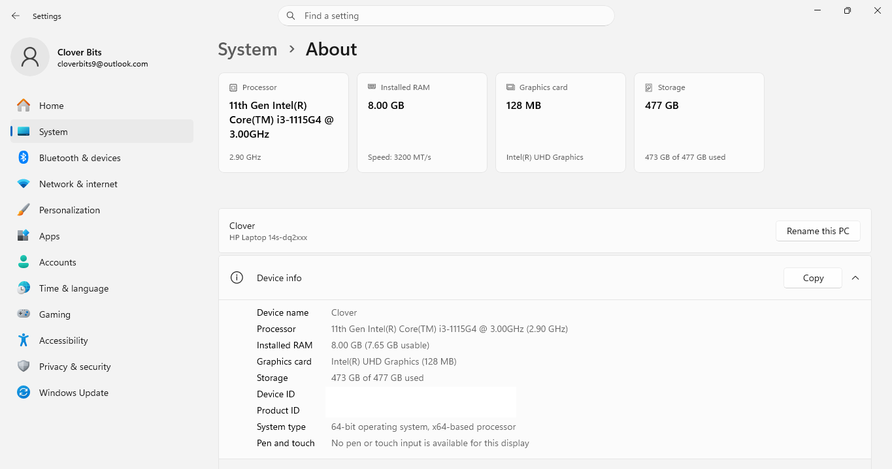

---

## 3. How the Code Works

### 3.0 In plain words

All four versions do the same job: go through the array, take the absolute value of each number, and add it to a running total.

- The **C** and **x86-64** versions handle **one number at a time**.
- The **SIMD** versions load several numbers into one wide register and process them **together** in a single instruction. An **XMM** register holds **2** doubles and a **YMM** register holds **4**, so in theory they do the work in half and a quarter of the steps.
- SIMD has no "absolute value" instruction for doubles. We compute it as **the larger of `x` and `-x`**.
- If `n` is not a multiple of 2 or 4, a short one-at-a-time loop finishes the last few numbers (Section 3.6).

### 3.1 Input data (documented)

Every vector is filled with **random doubles between -50 and 50**:

```c
A[i] = ((double)rand() / RAND_MAX) * 100.0 - 50.0;
```

The random generator is seeded once with `srand(67)` at the start of `main`, so every run of the program produces the same numbers. Within one test, all four kernels receive the **same** vector. About half of the values are negative, so the absolute value really matters.

### 3.2 The main program (`main.c`)

`main()` calls `run_test(n)` for each vector size. For each size, `run_test` does the following:

1. Allocates `n` doubles and fills them as described in 3.1.
2. Calls the C kernel, the x86-64 kernel, the XMM kernel and the YMM kernel with the same array and the same `n`.
3. Times each kernel (below).
4. Displays each result, and says `CORRECT` or `WRONG` for the three assembly versions.

**Vector sizes**
- Large sizes: `2^20`, `2^26`, `2^30`. _(TODO: if 2^30 (8 GB) did not fit in this machine's memory, write which size was used instead (2^28 or 2^29).)_
- Boundary sizes: `1, 3, 7, 1003, 1005` (explained in Section 3.6).

**Timing**
- Only the kernel call is timed, using `QueryPerformanceCounter`, which is a high-resolution timer.
- Each kernel is run once first without timing (a warm-up), then **30 times with timing**, and the **average** is reported.
- This is done in both the **Debug** and **Release** configurations of Visual Studio.

**Correctness**
- The C version is the answer key. The x86-64, XMM and YMM results are each compared to the C result.
- They are compared with a small tolerance (relative difference of at most `1e-8`) instead of exact equality. The SIMD versions add the numbers in a different order than the C loop, and with decimal numbers a different order can change the last few digits.

### 3.3 Version 2: x86-64 assembly, one number at a time (`asmfunc.asm`)

The kernel keeps a running total in `xmm0` and uses `r9` as the index. For each element it loads the number, checks whether it is negative, and if so multiplies it by -1.0 before adding it to the total.

```nasm
asm_loop:
    cmp r9, rdx
    JE done                     ; index reached n: finished
    movsd xmm1, [rcx+r9*8]      ; load A[i]
    movsd xmm2, [clear]         ; 0.0
    ucomisd xmm1, xmm2          ; compare A[i] with 0.0 (sets the carry flag if A[i] < 0)
    JNC adding                  ; not negative: skip the negation
    vmulsd xmm1, [negate]       ; negative: multiply by -1.0
adding:
    addsd xmm0, xmm1            ; total += |A[i]|
    inc r9
    JMP asm_loop
```

### 3.4 Version 3: SIMD with XMM registers, 2 numbers at a time (`xmm.asm`)

**Setup:** `xmm0` is the running total, set to zero. `-1.0` is copied into both halves of `xmm3` (`vmovddup`) so we can negate 2 numbers at once. If `n <= 0` the kernel returns 0.0.

**Main loop:** while at least 2 numbers remain, it loads 2 doubles, computes their absolute values, and adds them to the total.

```nasm
process_pairs:
    mov r10, rdx
    sub r10, r9                 ; how many elements are left
    cmp r10, 2
    jb reduce                   ; fewer than 2 left: leave the loop

    vmovupd xmm1, [rcx + r9*8]  ; load 2 doubles
    vmulpd xmm2, xmm1, xmm3     ; xmm2 = -x
    vmaxpd xmm1, xmm1, xmm2     ; xmm1 = larger of x and -x = |x|
    vaddpd xmm0, xmm0, xmm1     ; add both to the running total

    add r9, 2
    jmp process_pairs
```

**Absolute value:** multiplying by -1.0 gives `-x`, and `vmaxpd` keeps the larger of `x` and `-x`, which is always the non-negative one. This does the same thing as the scalar kernel, but for 2 numbers at once and without an if-check.

**Combining the two halves:** the running total in `xmm0` now holds two partial sums (one in each half). `vhaddpd xmm0, xmm0, xmm0` adds them together into one number.

**Leftover element:** at most 1 element can remain (when `n` is odd). The same scalar check-and-negate code as in Section 3.3 handles it.

### 3.5 Version 4: SIMD with YMM registers, 4 numbers at a time (`ymm.asm`)

This works the same way as the XMM kernel, but the registers are twice as wide. `-1.0` is copied into all four slots of `ymm3` (`vbroadcastsd`), and the loop runs while at least **4** numbers remain.

```nasm
process_groups:
    mov r10, rdx
    sub r10, r9                 ; how many elements are left
    cmp r10, 4
    jb remainder                ; fewer than 4 left: leave the loop

    vmovupd ymm1, [rcx + r9*8]  ; load 4 doubles
    vmulpd ymm2, ymm1, ymm3     ; -x
    vmaxpd ymm1, ymm1, ymm2     ; |x| = larger of x and -x
    vaddpd ymm0, ymm0, ymm1     ; add all 4 to the running total

    add r9, 4
    jmp process_groups
```

**Combining the four slots:** the total in `ymm0` holds 4 partial sums. `vextractf128` copies the upper 2 into a smaller register, `vaddpd` adds them to the lower 2, and `vhaddpd` adds those last 2 into one number.

**Leftover elements:** at most 3 elements can remain, and the scalar loop handles them.

**Cleanup:** `vzeroupper` before returning is a housekeeping instruction recommended after using YMM registers, so the code that runs afterwards is not slowed down. The return value in `xmm0` is kept.

### 3.6 Boundary handling: what happens when `n` is not a multiple of the vector size

A SIMD loop can only load a full group of numbers. If the array does not divide evenly, a few numbers are left over. Our kernels handle this with a short one-at-a-time loop after the main loop:

| Kernel | Numbers per step | Condition to run another step | Most numbers that can be left over |
| :--- | :-: | :--- | :-: |
| XMM | 2 | at least 2 remaining | 1 |
| YMM | 4 | at least 4 remaining | 3 |

**Example (the spec's n = 1003):**
- **YMM:** 250 steps of 4 = 1000 numbers, then the scalar loop handles the **3** that are left.
- **XMM:** 501 steps of 2 = 1002 numbers, then the scalar loop handles the **1** that is left.

The kernels never read past the end of the array, because a full group is only loaded when enough numbers remain, and the leftover loop reads exactly one double at a time. For `n = 1` and `n = 3`, the main loop never runs at all and only the leftover loop does the work.

**Boundary sizes tested:** `1, 3, 7, 1003, 1005`.

### 3.7 Instructions used in the SIMD kernels

| Instruction | What it does in our kernels | In the lecture slides? |
| :--- | :--- | :--- |
| `vmovupd` | loads 2 (XMM) or 4 (YMM) doubles from memory | yes (listed as the alternative to `vmovdqu`) |
| `vmovddup` | copies -1.0 into both halves of an XMM register | `MOVDDUP` is in the SSSE3 table |
| `vbroadcastsd` | copies -1.0 into all four slots of a YMM register | yes (broadcast slide) |
| `vmulpd` | multiplies the loaded numbers by -1.0 | `MULP[S/D]` is in the packed FP table |
| `vmaxpd` | keeps the larger of `x` and `-x` | `MAXP[S/D]` is in the packed FP table |
| `vaddpd` | adds to the running total | yes (packed addition slide) |
| `vhaddpd` | adds the two halves of a register together | yes (horizontal operation slide) |
| `vextractf128` | copies the upper half of a YMM register to an XMM register | yes (extract slide) |
| `vxorpd` / `vxorps` | sets a register to zero | yes (`vxorps` on the "initialize to 0" slide) |
| `vzeroupper` | cleanup after using YMM registers | in the AVX instruction list |
| `movsd`, `addsd`, `mulsd`, `ucomisd` | the one-at-a-time loops | `movsd` yes; the others are in the SSE/SSE2 tables |

_TODO: edit the last column to match what was actually shown in class (help here)_

---

## 4. Report

### i. Program output with execution time (all cases)

#### Debug
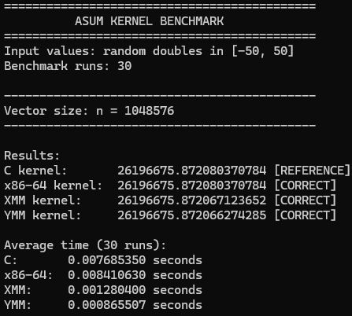
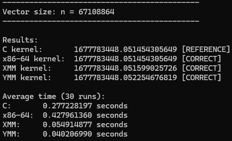
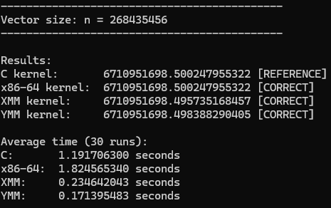

#### Release
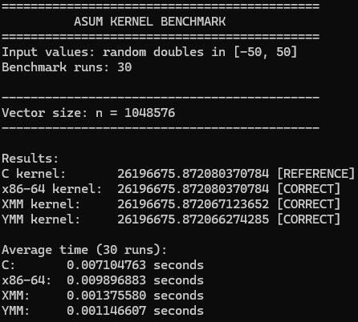
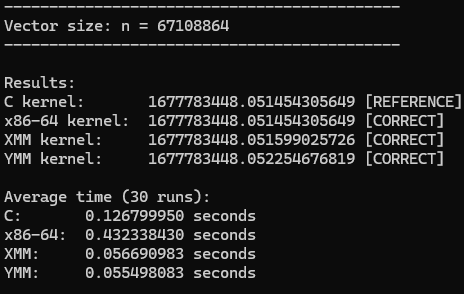
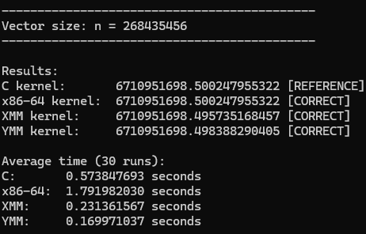

### ii. Comparative table of execution time

Average of 30 runs, in seconds.

#### Debug
| n | C | x86-64 | SIMD XMM | SIMD YMM |
| :--- | :-: | :-: | :-: | :-: |
| 2^20 | 0.0077 | 0.0084 | 0.0012 | 0.0009 |
| 2^26 | 0.2772 | 0.428 | 0.055 | 0.04021 |
| 2^30 (as fallback) | 1.1917 | 1.8246 | 0.2347 | 0.1714 |

#### Release
| n | C | x86-64 | SIMD XMM | SIMD YMM |
| :--- | :-: | :-: | :-: | :-: |
| 2^20 | 0.0071 | 0.01 | 0.0014 | 0.0011 |
| 2^26 | 0.1268 | 0.4323 | 0.0567 | 0.0555 |
| 2^27 (as fallback) | 0.5738 | 1.792 | 0.2314 | 0.17 |

### iii. Correctness check: C version
<!--  -->
_TODO: screenshot_

### iv. Correctness check: x86-64
<!--  -->
_TODO: screenshot_

### v. Correctness check: SIMD XMM
<!--  -->
_TODO: screenshot_

### vi. Correctness check: SIMD YMM
<!--  -->
_TODO: screenshot_

### vii. Boundary check: SIMD XMM and YMM
**Boundary Check for Debug:**

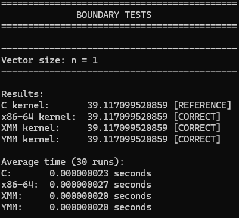
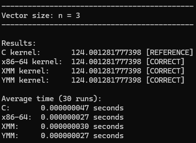
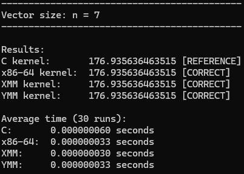
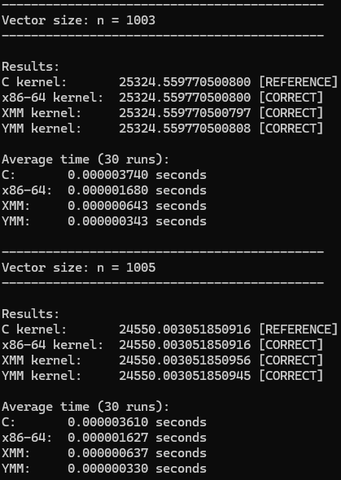

**Boundary Check for Release:**

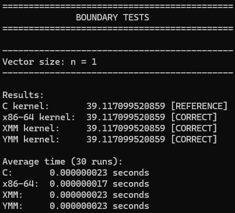
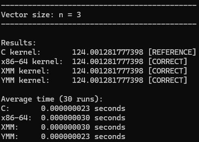

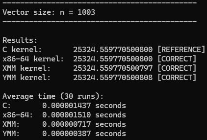
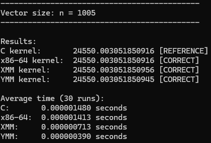


### viii. Analysis of results

_TODO: write this once the measurements are in. Questions to answer, with what our code design suggests (confirm or refute each one with the numbers):_

**Which version is fastest, and why?**
_TODO._

**AHAness: is the kernel memory-bound or compute-bound?**
- *Memory-bound* means the processor spends most of its time **waiting for numbers to arrive from RAM**. *Compute-bound* means it spends most of its time **doing the arithmetic**.
- ASUM does very little math per number (one absolute value and one add for every 8 bytes read), so for large arrays we expect it to be **memory-bound**: once the SIMD kernels process numbers faster than RAM can deliver them, making them wider does not help, and XMM and YMM should end up close together.
- For smaller arrays (2^20 = 8 MB) more of the data can sit in the processor's fast cache memory, so we expect YMM to show more of an advantage there.
- To check this, compute the speed at which each kernel reads data, `n × 8 bytes ÷ time`, and compare it to the memory bandwidth of the machine. _TODO._

**Will SIMD YMM be faster than optimized C?**
- Visual Studio's C compiler does not turn a floating-point sum into SIMD by default, because adding in a different order could change the result. So the C loop should behave like a one-at-a-time loop even in Release. _TODO: confirm with the Release numbers._

**Why is the speedup not the theoretical 2× (XMM) and 4× (YMM)?** Possible reasons to check:
- Memory speed becomes the limit before the arithmetic does.
- In every one of our kernels, each addition has to wait for the previous addition to finish, because there is only one running total. This limits how fast the loop can go, regardless of register width.
- The one-at-a-time leftover loop and the final combining of the partial sums add a little extra work (this matters mostly for small `n`).
- Debug vs Release and cache effects at different sizes.

**Why might the x86-64 version be slowest?** It checks the sign of every number with an if-style jump. With random values, about half the numbers are negative, so the processor often guesses the jump wrong and loses time. It also reloads 0.0 from memory on every step. _TODO: confirm with the numbers._

**Debug vs Release:** the assembly kernels are the same machine code in both, so only the C kernel and the surrounding program differ. _TODO._

### ix. Discussion of implementation, problems encountered, unique methodology, AHA moments

#### How we computed the absolute value of a double (unique methodology)

x86 SIMD has no instruction that returns the absolute value of doubles. We used the fact that **|x| is the larger of `x` and `-x`**:

1. `vmulpd` multiplies the loaded numbers by -1.0, giving `-x` exactly.
2. `vmaxpd` keeps the larger of `x` and `-x`, which is the non-negative one.

This is the SIMD version of what the scalar kernel does with an if-check, so all three assembly kernels share the same idea. It has no jump, so there is nothing for the processor to guess wrong, and the same approach works for both XMM and YMM.

**Why `max(x, -x)`?** The other ways to get `|x|` also need an instruction that was not demonstrated in class. Clearing the sign bit with a bit mask needs a logic instruction (`vandpd`) plus a mask constant. Comparing and blending needs a compare, a negate and a blend, so at least three instructions. The `max(x, -x)` method needs only two, a multiply and a max, and they are the same kind of packed arithmetic as the `vaddps` and `vhaddps` we learned. They also copy the logic of the scalar kernel, so all three assembly versions use the same idea. `vmulpd` and `vmaxpd` were not demonstrated in class, but they are the packed-double versions of `MULP[S/D]` and `MAXP[S/D]`, which are listed in the lecture slides.

#### Other design decisions
- **Counting what is left:** the loops check how many elements remain (`n - i`) before each step, so the leftover handling is simple and never reads out of bounds.
- **Using the full `n`:** `n` arrives as a 32-bit `int` in `edx`. The SIMD kernels run `mov edx, edx` so the upper half of the 64-bit register is guaranteed to be zero before it is used.
- **Checking with a tolerance:** SIMD results are compared with C using a small tolerance, not exact equality, because adding in a different order can change the last digits.

#### Possible improvements (not implemented)
- **Several running totals instead of one.** Our SIMD kernels keep one running total, so every add waits for the previous one. Using 2 to 4 separate totals and combining them at the end would let the processor overlap the adds and should make the SIMD kernels faster when the data is in cache.

#### Problems encountered and solutions
1. The absolute value of doubles.
- Problem: we needed `|x|` for SIMD doubles and the instructions taught in class could not do it.
- Solution: we used `|x| = max(x, -x)`, which is `vmulpd` by -1.0 plus `vmaxpd`. It mirrors what the scalar kernel does, and we explain the choice in section ix.
2. The assembly worked in Debug but not in Release.
- Problem: in Release, the build failed with "unresolved external symbol" errors for `asmkernel`, `xmmkernel` and `ymmkernel`.
- Solution: we had set the NASM Custom Build Tool only for Debug|x64, so in Release the `.asm` files were never assembled. We added the same NASM command and output file to the Release|x64 configuration for each `.asm` file.

#### AHA moments
1. A slightly different answer was not a bug. The SIMD results differed from the C result in the last few digits. We first suspected a bug, then realized the SIMD kernels add the numbers in a different order, and with decimal numbers a different order can change the last digits. That is why we compare with a small tolerance instead of exact equality. When you run it, you’ll probably see the x86-64 kernel match C exactly, because it adds in the same order, while the SIMD ones differ slightly.
2. A 32-bit int in a 64-bit register. n is passed as a 32-bit int but the loop uses the 64-bit register, and the upper half is not guaranteed to be zero. We clear it with `mov edx, edx` before using it.

---

## 5. Repository Contents

All files needed to load and run the program are in this repository.

```
CEPARCO-SIMD/
├── FinalProject/
│   ├── FinalProject.vcxproj          # Visual Studio project file (NASM build steps)
│   ├── FinalProject.vcxproj.filters
│   ├── main.c                        # main program, C kernel, timing, correctness check
│   ├── asmfunc.asm                   # x86-64 non-SIMD kernel
│   ├── xmm.asm                       # SIMD AVX2 kernel using XMM registers
│   └── ymm.asm                       # SIMD AVX2 kernel using YMM registers
├── screenshots/                      # images used in this report (to be added)
├── .gitattributes
├── .gitignore
├── FinalProject.sln                  # open this in Visual Studio
└── README.md
```
